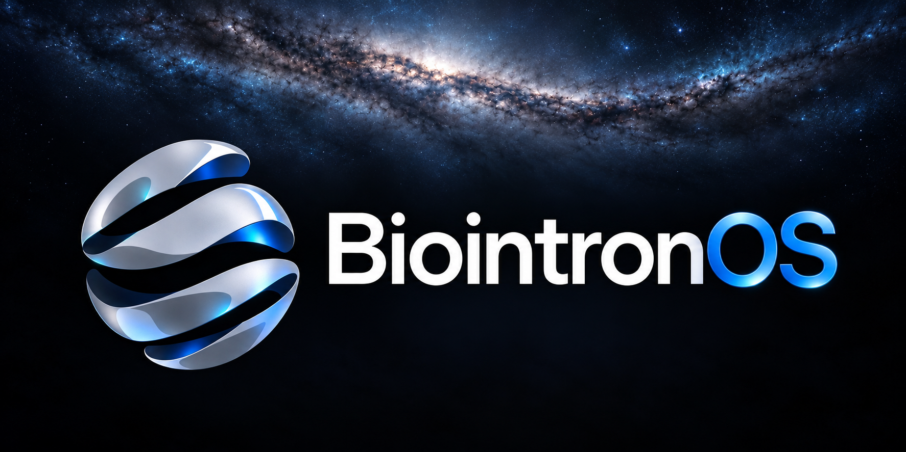
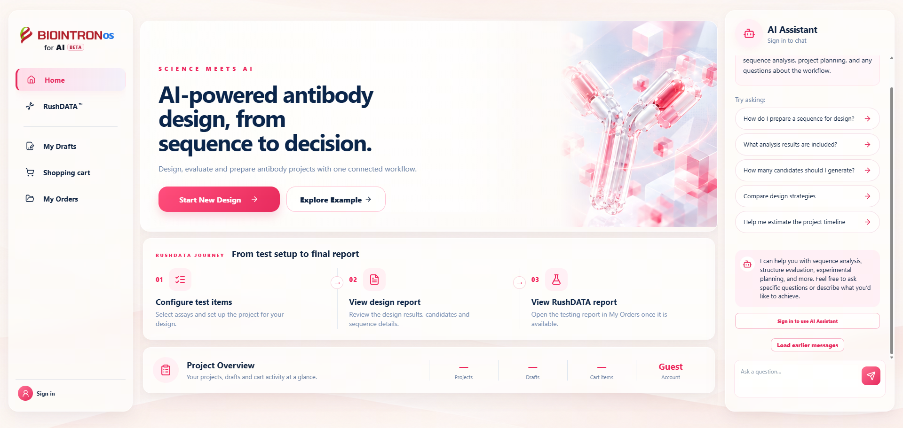

<div align="center">

<p dir="ltr">
<a href="../../README.md" lang="en" dir="ltr">English</a> ·
<a href="README.zh-CN.md" lang="zh-CN" dir="ltr">简体中文</a> ·
<a href="README.zh-TW.md" lang="zh-TW" dir="ltr">繁體中文</a> ·
<a href="README.ja.md" lang="ja" dir="ltr">日本語</a> ·
<a href="README.ko.md" lang="ko" dir="ltr">한국어</a> ·
<a href="README.tr.md" lang="tr" dir="ltr">Türkçe</a> ·
<a href="README.ru.md" lang="ru" dir="ltr">Русский</a> ·
<a href="README.vi.md" lang="vi" dir="ltr">Tiếng Việt</a> ·
<a href="README.th.md" lang="th" dir="ltr">ไทย</a> ·
<a href="README.de.md" lang="de" dir="ltr">Deutsch</a> ·
<a href="README.es.md" lang="es" dir="ltr">Español</a> ·
<a href="README.fr.md" lang="fr" dir="ltr">Français</a> ·
<a href="README.uk.md" lang="uk" dir="ltr">Українська</a> ·
<a href="README.pl.md" lang="pl" dir="ltr">Polski</a> ·
<a href="README.pt-BR.md" lang="pt-BR" dir="ltr">Português (Brasil)</a> ·
<strong lang="fa" dir="rtl">فارسی</strong> ·
<a href="README.ar.md" lang="ar" dir="rtl">العربية</a> ·
<a href="README.id.md" lang="id" dir="ltr">Bahasa Indonesia</a> ·
<a href="README.it.md" lang="it" dir="ltr">Italiano</a> ·
<a href="README.el.md" lang="el" dir="ltr">Ελληνικά</a> ·
<a href="README.ml.md" lang="ml" dir="ltr">മലയാളം</a> ·
<a href="README.ur-Latn.md" lang="ur-Latn" dir="ltr">Roman Urdu</a> ·
<a href="README.ro.md" lang="ro" dir="ltr">Română</a>
</p>

# Biointron OS

### عامل هوش مصنوعی خود را به خدمات Biointron متصل کنید.

از درخواست سفارش تا دریافت نتایج گزارش، گردش‌کارهای Biointron را به ابزارهایی بیاورید که همین حالا استفاده می‌کنید.<br />
MCP اتصال را فراهم می‌کند. Skills مراحل کار را راهنمایی می‌کند. کنترل در اختیار شما می‌ماند.

[](../../docs/tool-catalog.md)
[](../../skills/README.md)
[](../../LICENSE)
[](#beta)

<br />

<!-- HERO: Keep the artwork path in sync across all language versions. -->


<br />

**[شروع کنید](#get-started) · [ابزارهای MCP](../../docs/tool-catalog.md) · [Skills](../../skills/README.md) · [API و نمونه‌ها](../../docs/api.md) · [پلتفرم آنلاین](#online-platform) · [پرسش‌های متداول](#faq)**

</div>

<div dir="rtl">

---

## یک پلتفرم. سه راه برای اتصال.

Biointron OS رابطی برای دسترسی عامل‌های هوش مصنوعی، مدل‌ها و افراد به خدمات Biointron است. این پلتفرم دسترسی به خدمات و راهنمای گردش‌کار را یکپارچه می‌کند و نقشه راه آن سفارش‌ها، ارسال طرح‌ها، پیگیری پیشرفت و نتایج را در بر می‌گیرد.

| برای عامل‌ها | برای مدل‌ها | برای افراد |
| ---: | ---: | ---: |
| خدمات را از طریق **MCP** پیدا و فراخوانی کنید. | با **داده‌های ساخت‌یافته** و رابط‌های مستند کار کنید. | از طریق یک **رابط تعاملی** به گردش‌کارها دسترسی داشته باشید. |
| فراخوانی ابزارها را با Skills ویژه هر کار همراه کنید. | قراردادهای داده در مرحله Beta در حال هماهنگ‌سازی هستند. | تجربه وب به‌صورت جداگانه از این مخزن ارائه می‌شود. |

این مخزن محل عمومی انتشار Skills، راهنماهای اتصال، فهرست ابزارها و نمونه‌هاست. خدمات عملیاتی Biointron به‌صورت جداگانه اجرا می‌شوند.

<a id="get-started"></a>

## شروع کنید

### 1 · MCP را متصل کنید

توکن دسترسی به خدمت و مجوزهای لازم را از رابط خود در Biointron دریافت کنید. در یک کلاینت MCP که از **Streamable HTTP** و **احراز هویت Bearer** پشتیبانی می‌کند، موارد زیر را اضافه کنید:

| تنظیم | مقدار |
| ---: | ---: |
| نام | `BiointronOS_MCP` |
| انتقال | Streamable HTTP |
| نشانی | `https://mcp-rusta-order-blgdfvompw.cn-shanghai.fcapp.run/mcp` |
| احراز هویت | `Authorization: Bearer <MCP_ACCESS_TOKEN>` |

در کلاینت‌هایی که از قالب `mcpServers` پشتیبانی می‌کنند، این پیکربندی را با تنظیمات موجود ادغام کنید و مقدار جایگزین را با توکن خود عوض کنید:

```json
{
  "mcpServers": {
    "BiointronOS_MCP": {
      "url": "https://mcp-rusta-order-blgdfvompw.cn-shanghai.fcapp.run/mcp",
      "headers": {
        "Authorization": "Bearer <MCP_ACCESS_TOKEN>",
        "START_MCP_TIMEOUT_MS": "60000",
        "RUN_MCP_TIMEOUT_MS": "660000"
      }
    }
  }
}
```

دو سرآیند مهلت انتظار، موارد سفارشی این پیکربندی نمونه هستند: 60000 میلی‌ثانیه برابر با 60 ثانیه و 660000 میلی‌ثانیه برابر با 11 دقیقه است. این سرآیندها تنها در صورت پشتیبانی کلاینت یا خدمت اثر دارند؛ قرار دادن آن‌ها در `headers` به‌تنهایی تضمین نمی‌کند که زمان انتظار کلاینت تغییر کند. مهلت‌های انتظار را مطابق مستندات کلاینت خود تنظیم کنید.

برای جزئیات بیشتر، [راهنمای نصب](../../docs/installation.md#mcp) را ببینید.

### 2 · Skills را اضافه کنید

یکی از Skills موجود در [فهرست Skills](../../skills/README.md) را انتخاب کنید. پوشه کامل آن، شامل `references/` و هر اسکریپت همراه بسته، را دانلود کنید و در مسیر Skills عامل خود قرار دهید. برای Codex و Claude Code، بخش [نصب Skills](../../docs/installation.md#skills) را ببینید.

هر دو بسته اکنون در این مخزن موجودند: `skills/order_design/` برای `order-design` و `skills/auto_html_report/` برای `auto-html-report`. بسته‌ها قابل دانلود هستند؛ وجود آن‌ها به معنی تأیید کامل فرایندهای کسب‌وکار نیست.

### 3 · با یک آشنایی فقط‌خواندنی شروع کنید

```text
ابزارهای Biointron MCP موجود در این نشست را فهرست کن و کار هرکدام را توضیح بده.
بگو کدام قابلیت‌ها آماده‌اند و کدام هنوز در مرحله Beta هستند.
هیچ سفارشی ایجاد یا ارسال نکن.
```

پیدا کردن ابزارها نخستین بررسی اتصال است. موفقیت هر عملیات نیازمند اعتبارسنجی اتصال متناظر آن به سرویس پشتیبان است.

## فهرست ابزارهای MCP

| ابزار | کاربرد | اثر |
| ---: | ---: | ---: |
| `get_order_input_requirements` | به‌طور پیش‌فرض پرسش‌های مستقل را در دسته‌ها جمع‌آوری می‌کند؛ پیش از نوشتن، همه داده‌های مرحله را یک‌جا بررسی می‌کند. نیازی به JWT کسب‌وکار ندارد. | فقط خواندن |
| `search_order_antigens` | محصولات و مشخصات واقعی را با کلیدواژه جست‌وجو می‌کند و اطلاعات ادامه صفحه‌بندی را برمی‌گرداند. | فقط خواندن |
| `order_design_preflight` | بررسی صلاحیت شرکت و آزمون‌های موجود. | فقط خواندن |
| `start_order_design` | ارسال فایل XLSX ارائه‌شده و انتظار برای تأیید ذخیره طراحی. | نوشتن داده‌های عملیاتی |
| `get_order_design_result` | پس از انتخاب مشتری، HTML واقعی طرح ذخیره‌شده را فقط برای خواندن و تحویل دریافت می‌کند؛ سفارش را تغییر نمی‌دهد. | فقط خواندن |
| `add_order_to_cart` | افزودن طراحی با ذخیره تأییدشده به سبد سفارش. | نوشتن داده‌های عملیاتی |
| `end_order_workflow` | دستور حذف زمینهٔ محلی به کلاینت، بدون ابطال امضا یا لغو سفارش. | فقط دستور به کلاینت |
| `get_order_cart` | خواندن سبد سفارش‌ها. | فقط خواندن |
| `calculate_order_price` | دریافت قیمت برای سفارش‌های انتخاب‌شده. | فقط خواندن |
| `submit_verified_order` | قیمت را بررسی می‌کند و سفارش‌های انتخاب‌شده را برای تأیید انسانی ارسال می‌کند. | نوشتن داده‌های عملیاتی |
| `get_report_results` | دریافت نتایج گزارش‌های موجود در قالب JSON. | فقط خواندن |

پیاده‌سازی محلی **11 ابزار** دارد: 10 ابزار به JWT مشتری فعلی در `business_token` نیاز دارند؛ `get_order_input_requirements` به‌صورت محلی و بدون JWT کار می‌کند. این به‌روزرسانی هنوز مستقر نشده و عملکرد کامل فرایندها در محیط واقعی تأیید نشده است. [امضاها، وضعیت و محدودیت‌ها](../../docs/tool-catalog.md) را ببینید.

## Skills

| Skill | کاربرد | وضعیت انتشار |
| ---: | ---: | ---: |
| [طراحی سفارش · `order-design`](../../skills/order_design/SKILL.md) | معرفی بسته‌ها، جمع‌آوری مرحله‌ای اطلاعات در دسته‌ها، انتخاب از فهرست محصولات، نمایش اختیاری HTML طرح پس از ذخیره، بررسی سبد و قیمت‌ها و ارسال سفارش برای تأیید انسانی. | موجود در مخزن؛ قابل دانلود |
| [گزارش نتایج · `auto-html-report`](../../skills/auto_html_report/SKILL.md) | تولید گزارش‌های مستقل HTML به زبان‌های مختلف از JSON نتایج ارائه‌شده توسط کاربر، همراه با جدول‌های خلاصه، نمودارها و تصاویر موجود. | موجود در مخزن؛ قابل دانلود |

MCP عملیات را در دسترس قرار می‌دهد؛ Skills توضیح می‌دهد عامل چگونه در یک کار از آن‌ها استفاده کند. نصب Skill دسترسی به خدمت را فراهم نمی‌کند و MCP را به‌طور خودکار ثبت نمی‌کند. [مشاهده فهرست ←](../../skills/README.md)

سفارش ارسال‌شده منتظر تأیید Biointron می‌ماند؛ ارسال سفارش به معنی آغاز تولید یا پایان آزمایش نیست.

اگر JSON نتایج از قبل ارائه شده باشد، Skill با نام `auto-html-report` گزارش را محلی و بدون اطلاعات ورود یا اتصال MCP تولید می‌کند. اگر JSON موجود نباشد، در محدوده مجاز می‌توان با شماره سفارش و JWT مشتری فعلی از `get_report_results` نتیجه را دریافت و سپس گزارش را تولید کرد. شماره سفارش به‌تنهایی کافی نیست. JWT معتبر را دوباره استفاده کنید؛ فقط وقتی لازم است JWT دریافت شود، مقادیر موجود Biointron Account و App Key را استفاده کرده و موارد مفقود را بپرسید.

دستورالعمل‌های بسته گزارش به انگلیسی هستند، اما گزارش با زبان درخواستی مشتری تهیه می‌شود.

<a id="beta"></a>

## Beta Playground

Biointron OS در قالب Beta Playground معرفی می‌شود. برخی اتصال‌ها ممکن است هنوز در دسترس نباشند. نتیجه واقعی هر مرحله را گزارش کنید؛ موفقیت پاسخ HTTP یا نمایش نام یک ابزار به معنی تکمیل عملیات نیست.

ایجاد و ارسال سفارش به اجازه کاربر نیاز دارد. اگر زمان انتظار یک عملیات نوشتن به پایان رسید، پیش از تلاش دوباره وضعیت سفارش موجود را بررسی کنید. برای دریافت دسترسی یا پیگیری قابلیت‌هایی که هنوز در دسترس نیستند، با نماینده Biointron که حساب شما را فراهم کرده تماس بگیرید.

<a id="online-platform"></a>

## پلتفرم آنلاین Biointron

پلتفرم آنلاین Biointron فرایندهای پروژه‌های RushDATA را در مرورگر در دسترس قرار می‌دهد و امکان دسترسی به پیش‌نویس پروژه‌ها، سبد خرید، سفارش‌ها و یک دستیار هوش مصنوعی را فراهم می‌کند. برای آشنایی با خدمات موجود و مشاهده اطلاعات پروژه‌ها، پلتفرم را باز کنید.

[ورود به پلتفرم آنلاین Biointron ←](https://ai.biointron.com/#/landing)

<a href="https://ai.biointron.com/#/landing"></a>

<a id="faq"></a>

## پرسش‌های متداول

<details>
<summary><strong>آیا هم به MCP و هم به Skills نیاز دارم؟</strong></summary>

MCP ابزارهای قابل فراخوانی را فراهم می‌کند. Skills دستورالعمل‌های گردش‌کار را اضافه می‌کند و ممکن است وابستگی‌های خاص خود را داشته باشد. الزامات هر Skill منتشرشده را رعایت کنید؛ دانلود Skill به‌تنهایی اتصال به خدمت را برقرار نمی‌کند.

</details>

<details>
<summary><strong>آیا دیده شدن ابزار در فهرست به معنی آماده بودن آن برای استفاده عملیاتی است؟</strong></summary>

خیر. پیدا شدن ابزار فقط ثبت شدن آن را تأیید می‌کند. پیکربندی سرویس پشتیبان، دسترسی حساب و عملیات درخواست‌شده نیز باید اعتبارسنجی شوند. فهرست ابزارها این تفاوت را مشخص می‌کند.

</details>

<details>
<summary><strong>سرور و پیاده‌سازی منطق کسب‌وکار کجا هستند؟</strong></summary>

این مخزن مستندات عمومی یکپارچه‌سازی و Skills را توزیع می‌کند. خدمت میزبانی‌شده و پیاده‌سازی خصوصی منطق کسب‌وکار جداگانه نگهداری می‌شوند.

</details>

## مستندات

| از اینجا شروع کنید | منابع |
| ---: | ---: |
| [نصب MCP و Skills](../../docs/installation.md) | [فهرست ابزارهای MCP](../../docs/tool-catalog.md) |
| [فهرست Skills](../../skills/README.md) | [API و نمونه‌های JSON](../../docs/api.md) |
| [مشارکت](../../CONTRIBUTING.md) | [وضعیت مجوز](../../docs/license.md) |

راهنماهای تفصیلی به زبان‌های چینی و انگلیسی ارائه می‌شوند.

## مجوز

تحت مجوز [PolyForm Noncommercial 1.0.0](../../LICENSE) ارائه می‌شود. **این مجوز استفاده تجاری را مجاز نمی‌داند.** کد منبع این مخزن برای استفاده غیرتجاری در دسترس است. [دامنه و شرایط](../../docs/license.md) را ببینید.

</div>

---

<div align="center">
<sub>Biointron OS · برای عامل‌ها. برای مدل‌ها. برای افراد.</sub>
</div>

